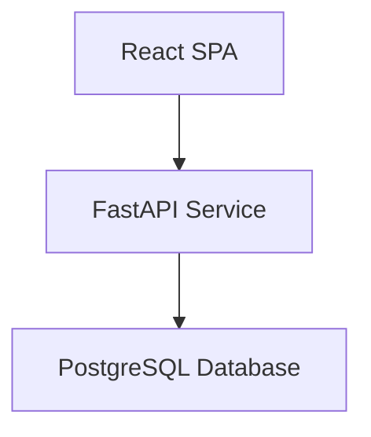
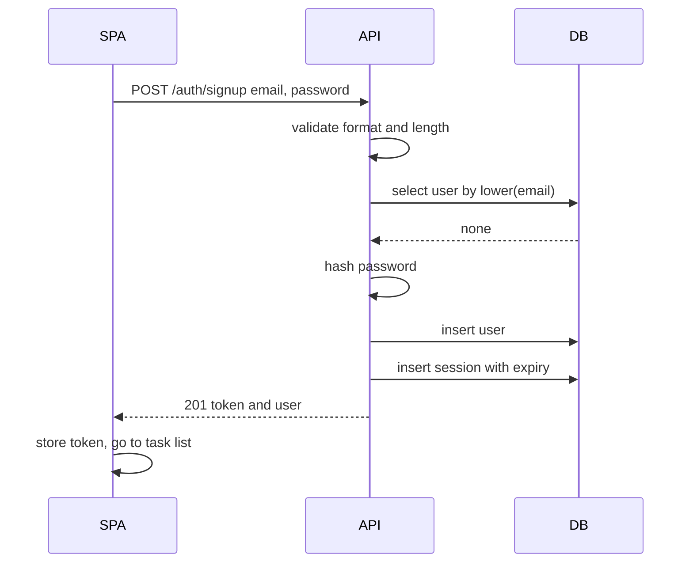
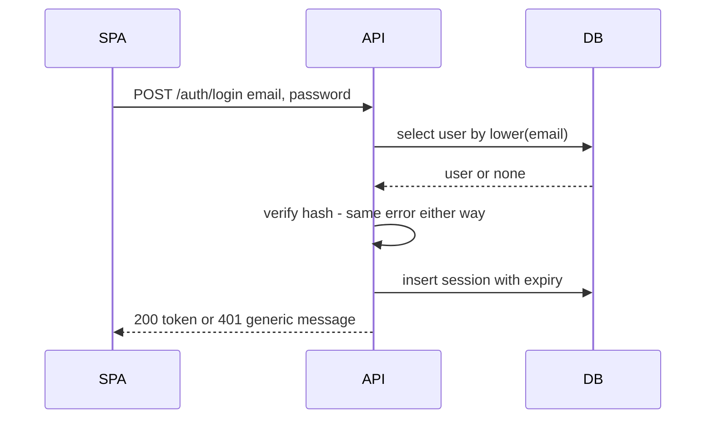
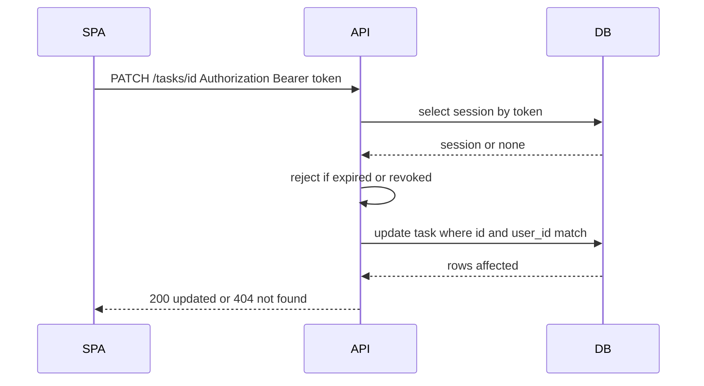
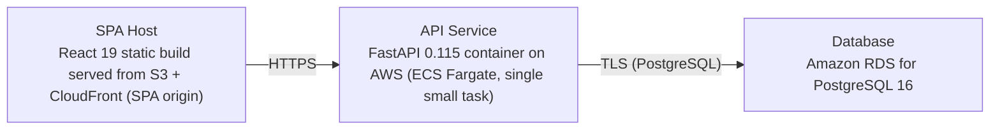

# Architecture

> Maintained by QuorQ AI SDLC. Text between `sdlc:auto` markers is regenerated; anything outside them is yours and is kept.

<!-- sdlc:auto:start narrative -->
## Overview

### ARCH-OVERVIEW · approved · source: architecture:v2:summary

This is a lightweight two-tier to-do web app: a React 19 SPA on one origin and a FastAPI 0.115 API on another, backed by PostgreSQL 16 and deployed on AWS. Sign-in uses server-side sessions with an opaque bearer token. All task access is scoped to the session user in the database.

- Status: approved; Version: 2.
- Topology:
  - React 19 SPA on one origin.
  - FastAPI 0.115 API on a different origin.
  - PostgreSQL 16 database.
  - Hosted on AWS.
- Authentication:
  - Server-side sessions, chosen because the SPA and API are on different origins.
  - The login response body returns an opaque bearer token.
  - The frontend stores the token and sends it as 'Authorization: Bearer' on every call.
  - Logout revokes the session server-side; sessions also expire after inactivity.
- Passwords are stored only as bcrypt hashes.
- Data:
  - Every task read and write is filtered by the session user's id in the database.
  - Deleting a user cascades to delete their tasks.
- Out of scope: outbound email, payments, third-party integrations.
- INCONSISTENCY IN INPUT:
  - The summary states 'Two tables (users, tasks) hold all data'.
  - The Entities list and the db component define three tables: users, sessions and tasks.
  - Both versions are recorded here; the difference is not resolved.

**Related:** ARCH-COMP-SPA, ARCH-COMP-API, ARCH-COMP-DB, ARCH-ENT-USERS, ARCH-ENT-SESSIONS, ARCH-ENT-TASKS

### ARCH-COMP-SPA · approved · source: architecture:v2:component:spa

The React 19 single-page app provides the whole user interface. It stores the bearer token, sends it on every API call, and redirects signed-out visitors to login.

- Technology: React 19.
- Responsibilities:
  - Sign-up and login UI.
  - Task list.
  - Inline edit of task titles.
  - Toggle a task between completed and not completed.
  - Delete with a confirmation prompt (the confirmation is handled in the SPA, not the API).
  - All / Active / Completed filtering.
  - Stores the bearer token and sends it as 'Authorization: Bearer' on every API call.
  - Redirects signed-out visitors to login, using GET /auth/me.

**Related:** ARCH-TECH-FRONTEND, ARCH-DEPLOY-SPA, ARCH-EP-AUTH-ME

### ARCH-COMP-API · approved · source: architecture:v2:component:api

The FastAPI 0.115 service handles authentication, session management, request validation and task CRUD. Every task operation is scoped server-side to the session user.

- Technology: FastAPI 0.115.
- Authentication: sign-up, login, logout.
- Sessions: opaque tokens with inactivity expiry and revocation.
- Request validation:
  - Email format.
  - Password length.
  - Title is trimmed and capped at 255 characters.
- Task CRUD is scoped server-side to the session user.

**Related:** ARCH-TECH-BACKEND, ARCH-DEPLOY-API, ARCH-CP-SIGNUP, ARCH-CP-LOGIN, ARCH-CP-TASK-AUTHZ

### ARCH-COMP-DB · approved · source: architecture:v2:component:db

PostgreSQL 16 stores users, sessions and tasks. The database itself enforces email uniqueness, task ownership and cascade delete.

- Technology: PostgreSQL 16.
- Stores:
  - Users (email, password hash).
  - Sessions.
  - Tasks.
- Enforces:
  - Case-insensitive email uniqueness.
  - A task-to-owner foreign key.
  - Cascade delete of a user's tasks when the user is deleted.

**Related:** ARCH-TECH-DATABASE, ARCH-DEPLOY-DB, ARCH-ENT-USERS, ARCH-ENT-SESSIONS, ARCH-ENT-TASKS

### ARCH-CP-SIGNUP · approved · source: architecture:v2:critical_path:signup

Sign-up validates the input, rejects duplicate emails, creates the user with a bcrypt hash and signs the user in automatically. The SPA then lands on the empty task list.

Steps:
1. Validate the email format and the password length.
2. Reject an already-registered email, compared case-insensitively.
3. Hash the password with bcrypt.
4. Create the user.
5. Open a session and return the opaque token.
6. The SPA lands on the empty task list.

**Related:** ARCH-EP-SIGNUP, ARCH-ENT-USERS, ARCH-ENT-SESSIONS

### ARCH-CP-LOGIN · approved · source: architecture:v2:critical_path:login

Login looks the user up by lowercased email and verifies the password hash. Any failure returns one identical generic message.

Steps:
1. Look up the user by lowercased email.
2. Verify the password hash.
3. On any mismatch, return the identical generic message.
4. On success, open a session and return the token.

**Related:** ARCH-EP-LOGIN, ARCH-ENT-USERS, ARCH-ENT-SESSIONS

### ARCH-CP-TASK-AUTHZ · approved · source: architecture:v2:critical_path:task_ownership

Every task read or write resolves and validates the session first. Ownership is then enforced by the user id in the query itself.

For every task read or write:
1. Resolve the session from the bearer token.
2. Reject an expired or revoked token.
3. Refresh the inactivity window.
4. Filter by, or check ownership against, the session user's id in the query.

Result: no other user's task is ever touched.

**Related:** ARCH-EP-TASKS-LIST, ARCH-EP-TASKS-CREATE, ARCH-EP-TASKS-PATCH, ARCH-EP-TASKS-DELETE, ARCH-ENT-TASKS, ARCH-ENT-SESSIONS

### ARCH-ENT-USERS · approved · source: architecture:v2:entity:users

The users table holds account records. Email is unique case-insensitively, and the password is stored only as a bcrypt hash.

- Fields: id, email, password_hash, created_at.
- Email uniqueness is case-insensitive, enforced via citext or a lower(email) unique index.
- Deleting a user cascades to delete their tasks.

**Related:** ARCH-COMP-DB, ARCH-ENT-TASKS, ARCH-ENT-SESSIONS

### ARCH-ENT-SESSIONS · approved · source: architecture:v2:entity:sessions

The sessions table holds server-side sessions keyed by an opaque token. Sessions support inactivity expiry and revocation.

- Fields: id, token, user_id, created_at, expires_at.
- Used for inactivity expiry and for revocation on logout.
- NOTE: this table is in the Entities list and the db component, but the architecture summary says only two tables (users, tasks) hold all data. See ARCH-OVERVIEW.

**Related:** ARCH-COMP-DB, ARCH-ENT-USERS, ARCH-EP-LOGOUT

### ARCH-ENT-TASKS · approved · source: architecture:v2:entity:tasks

The tasks table holds each user's tasks. A foreign key ties each task to its owner.

- Fields: id, user_id, title, completed, created_at.
- user_id is a foreign key to users, with cascade delete.
- Title: trimmed, required, maximum 255 characters (enforced by the API).
- A new task starts as not completed.

**Related:** ARCH-COMP-DB, ARCH-ENT-USERS

### ARCH-EP-SIGNUP · approved · source: architecture:v2:endpoint:POST /auth/signup

POST /auth/signup creates an account and signs the user in. It rejects invalid input and duplicate emails, and reports multiple errors together.

Rejects:
- An invalid email format.
- A blank field.
- A password under 8 characters.
- An already-registered email (case-insensitive), with an explicit 'already registered' message.

Multiple errors are reported together.

**Related:** ARCH-CP-SIGNUP

### ARCH-EP-LOGIN · approved · source: architecture:v2:endpoint:POST /auth/login

POST /auth/login signs the user in with email and password. Email matching is case-insensitive.

- Email matching is case-insensitive.
- Any failure returns the identical generic message: 'email or password is incorrect'.

**Related:** ARCH-CP-LOGIN

### ARCH-EP-AUTH-ME · approved · source: architecture:v2:endpoint:GET /auth/me

GET /auth/me returns the signed-in user. The SPA uses it to decide redirects.

The SPA uses this endpoint to:
- Redirect a signed-in visitor away from login and sign-up.
- Redirect a signed-out visitor to login.

**Related:** ARCH-COMP-SPA

### ARCH-EP-LOGOUT · approved · source: architecture:v2:endpoint:POST /auth/logout

POST /auth/logout ends the current session immediately. The token can no longer be used afterward.

- Ends the current session immediately, so its token can no longer be used.
- The input lists this endpoint as 'post /auth/logout' (lowercase). It is recorded here as POST.

**Related:** ARCH-ENT-SESSIONS

### ARCH-EP-TASKS-LIST · approved · source: architecture:v2:endpoint:GET /tasks

GET /tasks lists the signed-in user's own tasks, newest first, on one page. Results can optionally be filtered.

- Returns only the signed-in user's tasks.
- Sorted newest-first; no pagination (one page).
- Optional filter passed as a query parameter.
- Filter state is never stored server-side.

**Related:** ARCH-CP-TASK-AUTHZ

### ARCH-EP-TASKS-CREATE · approved · source: architecture:v2:endpoint:POST /tasks

POST /tasks creates a task for the signed-in user. The title is validated before the task is saved.

- Title is trimmed.
- Title is required: it is rejected if empty after trimming.
- Title is capped at 255 characters.
- A new task starts as not completed.

**Related:** ARCH-CP-TASK-AUTHZ, ARCH-ENT-TASKS

### ARCH-EP-TASKS-PATCH · approved · source: architecture:v2:endpoint:PATCH /tasks/{id}

PATCH /tasks/{id} edits the title and/or toggles completed on a task the user owns. It returns 404 for a task the user does not own.

- Can change the title, the completed flag, or both.
- The title rules (trim, required, 255-character cap) are re-applied.
- Returns 404 if the task is not owned by the session user.

**Related:** ARCH-CP-TASK-AUTHZ, ARCH-ENT-TASKS

### ARCH-EP-TASKS-DELETE · approved · source: architecture:v2:endpoint:DELETE /tasks/{id}

DELETE /tasks/{id} permanently deletes a task the user owns. The delete cannot be undone.

- Hard delete with no undo.
- Returns 404 if the task is not owned by the session user.
- The confirmation prompt is handled in the SPA.

**Related:** ARCH-CP-TASK-AUTHZ, ARCH-COMP-SPA

### ARCH-DEPLOY-SPA · approved · source: architecture:v2:deployment:SPA Host

The React 19 static build is served from S3 behind CloudFront. This is the SPA origin.

- Host: S3 + CloudFront, as the SPA origin.
- Runtime: static assets from a Vite build.

**Related:** ARCH-COMP-SPA

### ARCH-DEPLOY-API · approved · source: architecture:v2:deployment:API Service

The FastAPI 0.115 container runs on AWS ECS Fargate as a single small task.

- Host: AWS ECS Fargate, single small task.
- Runtime: Python 3.12 / Uvicorn.

**Related:** ARCH-COMP-API

### ARCH-DEPLOY-DB · approved · source: architecture:v2:deployment:Database

The database is Amazon RDS for PostgreSQL 16.

- Host: Amazon RDS for PostgreSQL 16.
- Encryption at rest is cited in the Cloud technology decision.

**Related:** ARCH-COMP-DB

### ARCH-TECH-FRONTEND · approved · source: architecture:v2:tech_decision:Frontend

React 19 was chosen for the frontend over Vue and Svelte.

- Rationale: the whole product is one interactive screen, which React handles directly. That screen covers add, inline rename, toggle, delete-with-confirm and filter, all without reloading.
- One responsive codebase covers phone and desktop, with no separate mobile build.
- The SPA stores the bearer token and sends it as Authorization on every call.
- Alternatives considered: Vue, Svelte.

**Related:** ARCH-COMP-SPA

### ARCH-TECH-BACKEND · approved · source: architecture:v2:tech_decision:Backend

FastAPI 0.115 was chosen for the backend over Django REST Framework and Flask.

- Rationale: built-in Pydantic validation enforces these rules in one layer:
  - Email format.
  - Password length.
  - Trimmed, required, 255-character title.
- A single dependency enforces the 'filter every task by the session user' rule.
- Alternatives considered: Django REST Framework, Flask.

**Related:** ARCH-COMP-API

### ARCH-TECH-DATABASE · approved · source: architecture:v2:tech_decision:Database

PostgreSQL 16 was chosen for the database over MySQL and SQLite.

- Rationale: two tables with a task-to-owner foreign key.
- The database itself enforces ownership and cascade-deletes a user's tasks.
- citext, or a lower(email) unique index, enforces one account per email case-insensitively.
- Alternatives considered: MySQL, SQLite.

**Related:** ARCH-COMP-DB, ARCH-ENT-USERS, ARCH-ENT-TASKS

### ARCH-TECH-CLOUD · approved · source: architecture:v2:tech_decision:Cloud

AWS was chosen as the cloud provider over Azure and GCP.

- Rationale: one small region covers:
  - A static SPA origin.
  - A small API container (ECS Fargate).
  - Managed PostgreSQL (RDS) with encryption at rest.
- Leaves room to grow if excluded features return.
- Alternatives considered: Azure, GCP.

**Related:** ARCH-DEPLOY-SPA, ARCH-DEPLOY-API, ARCH-DEPLOY-DB
<!-- sdlc:auto:end narrative -->

<!-- sdlc:auto:start building-blocks -->
## Building Block View

| ID | Name | Technology | Responsibility | Depends on |
|---|---|---|---|---|
| spa | React SPA | React 19 | Single-page UI for sign-up, login, the task list, inline edit, toggle, delete-with-confirm and All/Active/Completed filtering; stores the bearer token and sends it on every API call; redirects signed-out visitors to login. | api |
| api | FastAPI Service | FastAPI 0.115 | Authentication (sign-up, login, logout), opaque session tokens with inactivity expiry and revocation, request validation (email format, password length, trimmed title, 255-char cap), and task CRUD scoped server-side to the session user. | db |
| db | PostgreSQL Database | PostgreSQL 16 | Stores users (email, password hash), sessions and tasks; enforces case-insensitive email uniqueness, the task-to-owner foreign key, and cascade delete of a user's tasks. | — |

<!-- sdlc:auto:end building-blocks -->

<!-- sdlc:auto:start runtime -->
## Runtime View

### Sign-up and auto sign-in

Validate email format and password length, reject an already-registered email case-insensitively, hash the password with bcrypt, create the user, open a session and return the opaque token so the SPA lands on the empty task list.

- **Components:** spa, api, db
- **Modules:** auth_router, auth_service, password_hasher, session_store, user_repo
- **Key functions:** sign_up(email, password), normalize_email(email), hash_password(password), create_session(user_id)

### Login with generic failure

Look up the user by lowercased email, verify the password hash, and on any mismatch return the identical generic message; on success open a session and return the token.

- **Components:** spa, api, db
- **Modules:** auth_router, auth_service, password_hasher, session_store, user_repo
- **Key functions:** login(email, password), verify_password(password, hash), create_session(user_id)

### Authenticated task action with ownership check

Every task read or write resolves the session from the bearer token, rejects an expired or revoked token, refreshes the inactivity window, and filters or checks ownership by the session user's id in the query so no other user's task is ever touched.

- **Components:** spa, api, db
- **Modules:** auth_dependency, session_store, tasks_router, tasks_service, task_repo
- **Key functions:** require_session(authorization), touch_session(session_id), list_tasks(user_id, filter), update_task(user_id, task_id, fields), delete_task(user_id, task_id)

<!-- sdlc:auto:end runtime -->

<!-- sdlc:auto:start deployment-view -->
## Deployment View

| Name | Service | Runtime | Scaling | Environment |
|---|---|---|---|---|
| SPA Host | React 19 static build served from S3 + CloudFront (SPA origin) | Static assets (Vite build) | CDN-distributed | dev |
| API Service | FastAPI 0.115 container on AWS (ECS Fargate, single small task) | Python 3.12 / Uvicorn | Single task for dev; horizontally scalable | dev |
| Database | Amazon RDS for PostgreSQL 16 | PostgreSQL 16 | Single instance, encryption at rest enabled | dev |

| Source | Target | Protocol |
|---|---|---|
| SPA Host | API Service | HTTPS |
| API Service | Database | TLS (PostgreSQL) |

<!-- sdlc:auto:end deployment-view -->

<!-- sdlc:auto:start decisions -->
## Architecture Decisions

| Layer | Choice | ADR |
|---|---|---|
| Frontend | React 19 | [ADR-0001](adr/frontend.md) |
| Backend | FastAPI 0.115 | [ADR-0002](adr/backend.md) |
| Database | PostgreSQL 16 | [ADR-0003](adr/database.md) |
| Cloud | AWS | [ADR-0004](adr/cloud.md) |
<!-- sdlc:auto:end decisions -->

<!-- sdlc:auto:start links -->
## Related Documents

- [Data Model](data-model.md)
- [API Specification](api/openapi.yaml)
- [Architecture Decision Records](adr/README.md)
<!-- sdlc:auto:end links -->
