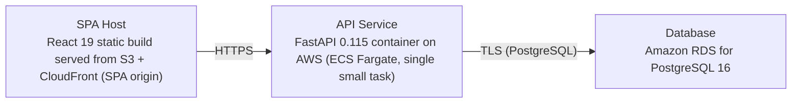

# Deployment Guide

> Maintained by QuorQ AI SDLC. Text between `sdlc:auto` markers is regenerated; anything outside them is yours and is kept.

<!-- sdlc:auto:start how-it-deploys -->
Pushes to `main` run `.github/workflows/deploy.yml`, which builds the API image (if there is a backend) and deploys the SPA to AWS Amplify. Commits touching only `docs/sdlc/**` don't deploy. Deployments can also be started from the platform's Deployment tab.
<!-- sdlc:auto:end how-it-deploys -->

<!-- sdlc:auto:start environments -->
| Name | Service | Runtime | Scaling | Environment |
|---|---|---|---|---|
| SPA Host | React 19 static build served from S3 + CloudFront (SPA origin) | Static assets (Vite build) | CDN-distributed | dev |
| API Service | FastAPI 0.115 container on AWS (ECS Fargate, single small task) | Python 3.12 / Uvicorn | Single task for dev; horizontally scalable | dev |
| Database | Amazon RDS for PostgreSQL 16 | PostgreSQL 16 | Single instance, encryption at rest enabled | dev |
<!-- sdlc:auto:end environments -->

<!-- sdlc:auto:start live -->
**Frontend URL:** https://p6cbdbbdaf276.d3j61xaup4zgrx.amplifyapp.com

**Backend URL:** https://44-229-176-71.sslip.io/apps/6cbdbbdaf276/

**Database:** PostgreSQL · app

**Version:** e16062916c2d

**Commit:** `e160629`

**Finished:** 2026-11-17
<!-- sdlc:auto:end live -->

<!-- sdlc:auto:start topology -->

<!-- sdlc:auto:end topology -->
